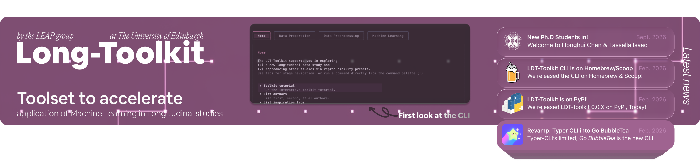

    

# ❝ Who are we, Long-Toolkit?

**Long-Toolkit** was founded by **Dr Alex Kwong and Simon Provost** during Simon's research internship with the **Lifecourse Epidemiology and Psychiatry Research Group (LEAP)** at the **University of Edinburgh**. Since then, PhD students **Bianca Branco, Honghui Chen and Isaac Tassella** have joined discussions, development or the toolkit's use at the University of Edinburgh, all supervised by **Dr Alex Kwong**.

We build **open-source Python toolkits for longitudinal data** to help researchers prepare and preprocess repeated measures, compare **standard and longitudinal machine learning against a statistical baseline** under one shared protocol, and explain the resulting predictions. A **no-code command-line interface** makes these tools accessible without writing Python.

Come give it a try: explore the [documentation](https://long-toolkit.readthedocs.io/en/latest/) and the [main repository](https://github.com/Long-Toolkit/long-toolkit). Supports `Python 3.10` only. Available on `macOS` and `Linux`, and on `Windows` (via Docker).

# ❝ Reach out if you would like to contribute ideas, requests or features!

_👉 Whoever you are, you are welcome!_

Whether you have a research question, a feature request, a bug report or a new tool to contribute, we would love to hear from you. [Open an issue](https://github.com/Long-Toolkit/long-toolkit/issues) or [contact Alex](mailto:akwong@ed.ac.uk) to discuss your ideas.

Find out more about the group and its research on [LEAP's website](https://life-epi-psych.github.io/).

Cheers! 🍻
